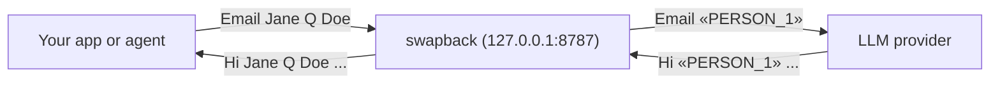

<p align="center">
  
</p>
<h1 align="center">swapback</h1>

<p align="center"><b>Your data stays yours.</b> A local proxy that swaps names, emails, phones and keys for placeholders before a prompt reaches an LLM provider, and puts them back in the reply.</p>

<p align="center">
  <a href="https://pypi.org/project/swapback/"></a>
  <a href="https://github.com/rmpmrepo1278/swapback/actions/workflows/tests.yml"></a>
  <a href="https://github.com/rmpmrepo1278/swapback/blob/main/LICENSE"></a>
  <a href="https://pypi.org/project/swapback/"></a>
  <a href="https://pepy.tech/projects/swapback"></a>
</p>

<p align="center">
  <picture>
    <source media="(prefers-color-scheme: dark)" srcset="docs/assets/demo-dark.gif">
    <source media="(prefers-color-scheme: light)" srcset="docs/assets/demo-light.gif">
    
  </picture>
</p>

## Quickstart

```bash
pip install swapback
swapback demo
swapback init && swapback-proxy
```

Python 3.11 or newer. `swapback demo` runs a fake model with made-up data: no key, no network. The proxy listens on
`127.0.0.1:8787`; point your client at it and change nothing else:

```python
from openai import OpenAI
client = OpenAI(
    base_url="http://127.0.0.1:8787/v1")
```

### Set it up for a real provider

`swapback init` writes `swapback.yaml` and `known.yaml`. Put the names, emails, phones and IDs that must never reach a
provider in `known.yaml` (or build it from a contacts export with `swapback known init --vcf contacts.vcf`), set
`upstream:` in `swapback.yaml`, run `swapback check-config`, then start `swapback-proxy`. The full steps, including
OpenRouter and Anthropic base URLs, are in the [guide](docs/guide.md#set-it-up-for-a-real-provider).

## Works with

- **[OpenClaw](https://github.com/openclaw/openclaw)**: tested end to end (2026.10.7) with one provider block; its
  `exec`, `web_fetch`, `web_search`, `browser` and `message` tools keep placeholders by default.
  [Config](docs/guide.md#use-with-agents).
- **Any OpenAI-compatible client**: OpenAI Chat Completions and Responses (the official SDKs, OpenRouter, LiteLLM
  clients). Set the base URL, change nothing else.
- **Anthropic Messages**: the Anthropic SDK, plain and streamed, including `tool_use`.
- Tool-policy recipes for Claude Code and Codex CLI: [framework recipes](docs/guide.md#framework-recipes).

## How it works



1. **Swap.** Values from your own list are matched in their common spellings (case, separators, escapes, nested JSON);
   detectors catch phones, emails, cards, IBANs and API keys you did not list. Each becomes a typed placeholder.
2. **Check.** An egress re-check scans the outgoing request again. If anything listed is still there, or the scrub
   fails, the request is blocked (`503`). It fails closed.
3. **Restore.** Placeholders in the reply are put back byte-exact, in plain and streamed replies and in tool-call
   arguments. Network, shell and send-style tool calls keep the placeholder unless you allow the tool, so a
   prompt-injected `web_fetch` cannot carry your email out.

No model to download and nothing probabilistic: exact matching plus patterns, about 5,900 lines of Python, 3
dependencies. Re-run the leak test yourself with `swapback selftest` (made-up data, 7 request paths, about 10 s).

## Documentation

| Topic | Where |
|---|---|
| Why swapback, setup, agents, tool calls, configuration, hooks | [docs/guide.md](docs/guide.md) |
| What it does not catch, and security notes | [docs/limits.md](docs/limits.md) |
| Leak test, performance, detection score | [docs/testing.md](docs/testing.md) |
| Comparison with PasteGuard, Maskit, Veil, piighost and Kiji | [docs/comparison.md](docs/comparison.md) |
| Changes per release | [CHANGELOG.md](CHANGELOG.md) |
| Reporting a vulnerability | [SECURITY.md](SECURITY.md) |

Project facts: Python 3.11+, about 5,900 lines (302 KB), 3 dependencies (PyYAML, phonenumbers, pyahocorasick), stdlib
HTTP server, MIT.

## Development

```bash
pip install -e ".[test]"
pytest -q                      # the full suite, including the holdout score as a regression floor
python evals/run_holdout.py    # the detection score table in docs/testing.md (--misses lists the cases not caught)
python examples/smoke.py       # end-to-end: mock upstream + proxy, plain and streamed
```

The vendored rule sets live
in `swapback/vendor` (see `THIRD_PARTY_NOTICES.md`); `tools/build_vendor.py` regenerates the Presidio patterns.

See [CONTRIBUTING.md](https://github.com/rmpmrepo1278/swapback/blob/main/CONTRIBUTING.md) and the [changelog](https://github.com/rmpmrepo1278/swapback/blob/main/CHANGELOG.md).

## Roadmap

- ~~Restore Anthropic Messages streams.~~ Done in 0.1.1.
- ~~Catch separator and case variants of listed values (NBSP, `.`, `_`, `-`, `%20`, all caps) under one placeholder.~~
  Done in 0.1.1.
- ~~Restore OpenAI Responses API streams.~~ Done in 0.3.0.
- ~~Keep placeholders in tool calls that could send data out.~~ Done in 0.3.0.
- ~~Build the known-values file from a contacts export.~~ Done in 0.3.0 (`swapback known init`).
- Optional, pluggable NER for names you never listed, off by default.
- More national ID and address patterns, with tests from synthetic data.
- ~~Release on PyPI.~~ Done: `pip install swapback`.
- ~~Hooks for spend caps, local fallback and usage accounting.~~ Done in 0.4.0.
- ~~A public, re-runnable leak test.~~ Done in 0.4.2 (`swapback selftest`).

Ideas and pull requests are welcome; open an issue first for anything large.

## License

MIT, see [LICENSE](https://github.com/rmpmrepo1278/swapback/blob/main/LICENSE). Bundled rule data: gitleaks (MIT) and Microsoft Presidio (MIT), see
[THIRD_PARTY_NOTICES.md](https://github.com/rmpmrepo1278/swapback/blob/main/THIRD_PARTY_NOTICES.md).
